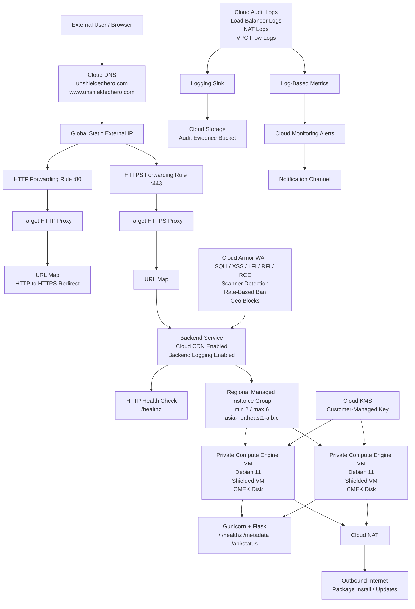

# 🌌 Event Horizon — Secure GCP Global Web Platform

<p align="center">
  
</p>

<p align="center">
  A production-inspired Google Cloud infrastructure project that deploys a private, autoscaled web application behind a global HTTPS load balancer with Cloud Armor WAF rules, Cloud CDN caching, customer-managed encryption, DNS, TLS, audit logging, and operational monitoring.
</p>

<p align="center">
  
  
  
  
  
  
  
  
</p>

---

## 📋 Table of Contents

- [📌 Lab Objective](#-lab-objective)
- [🏗️ Architecture](#️-architecture)
- [📊 Architecture Diagram](#-architecture-diagram)
- [🖥️ Project Overview](#️-project-overview)
- [🧰 Requirements](#-requirements)
- [📁 Project Structure](#-project-structure)
- [⚙️ Implementation Steps](#️-implementation-steps)
- [🧪 Validation & Testing](#-validation--testing)
- [🏢 Enterprise Architecture Mapping](#-enterprise-architecture-mapping)
- [🔐 Security Architecture](#-security-architecture)
- [📊 Observability](#-observability)
- [🔁 CI/CD Pipeline Simulation](#-cicd-pipeline-simulation)
- [⚖️ Scaling Considerations](#️-scaling-considerations)
- [🧩 Multi-Service Expansion](#-multi-service-expansion)
- [📸 Artifacts](#-artifacts)
- [🧹 Teardown](#-teardown)
- [🧠 Lessons Learned](#-lessons-learned)
- [🧪 Troubleshooting](#-troubleshooting)
- [🚧 Current Limitations](#-current-limitations)
- [📚 References](#-references)
- [👥 Author](#-author)

---

## 📌 Lab Objective

The objective of this project is to build a secure, production-style Google Cloud web platform using Terraform.

The project proves that a public web application can be deployed without exposing backend virtual machines directly to the internet. Instead, users enter through a controlled global load balancing layer, traffic is inspected by Cloud Armor, static responses can be cached by Cloud CDN, backend compute is deployed through a regional managed instance group, and operational evidence is captured through logging, metrics, uptime checks, and alert policies.

This project focuses on the following engineering outcomes:

- Build repeatable Google Cloud infrastructure with Terraform.
- Deploy private Compute Engine web servers using an instance template.
- Run a Python Flask/Gunicorn application from a startup script.
- Place the backend application behind a regional managed instance group.
- Expose the service through a global external HTTP/HTTPS load balancer.
- Redirect HTTP traffic to HTTPS.
- Use a custom domain with Cloud DNS records.
- Configure TLS using Google-managed certificates and Certificate Manager experimentation.
- Attach Cloud Armor WAF rules to the backend service.
- Enable Cloud CDN caching on the backend service.
- Encrypt compute boot disks with a customer-managed KMS key.
- Capture audit logs into a Cloud Storage evidence bucket.
- Create uptime, performance, WAF, configuration-change, and credential-security alerts.
- Validate the application through `/`, `/healthz`, `/metadata`, and `/api/status`.

---

## 🏗️ Architecture

At a high level, this project deploys a secured web application platform on Google Cloud.

The public entry point is a global external load balancer. The load balancer owns the public IP address, handles HTTP/HTTPS frontend traffic, redirects HTTP to HTTPS, applies URL map routing, and forwards valid traffic to a backend service.

The backend service is protected by Cloud Armor and accelerated with Cloud CDN. It sends traffic only to healthy instances in a regional managed instance group. The instances are created from a hardened Compute Engine instance template, run in private subnets, and use Cloud NAT for outbound internet access.

The application itself is generated by the startup script. The startup script installs Python, creates a virtual environment, installs Flask and Gunicorn, writes the application code, creates a systemd service, starts Gunicorn on port `80`, and validates the local `/healthz` endpoint.

### Traffic Flow

```text
User
  ↓
Cloud DNS: unshieldedhero.com / www.unshieldedhero.com
  ↓
Global Static IP Address
  ↓
HTTP Forwarding Rule :80
  ↓
Target HTTP Proxy
  ↓
HTTP URL Map Redirect
  ↓
HTTPS Forwarding Rule :443
  ↓
Target HTTPS Proxy
  ↓
HTTPS URL Map
  ↓
Backend Service
  ├── Cloud Armor WAF Policy
  ├── Cloud CDN Policy
  ├── Backend Logging
  └── Health Check: /healthz
        ↓
Regional Managed Instance Group
        ↓
Private Compute Engine VM
        ↓
Gunicorn + Flask Application
```

### Private Compute and Egress Flow

```text
Private Compute Engine VM
  ↓
Private Subnet
  ↓
Cloud Router
  ↓
Cloud NAT
  ↓
Debian Package Repositories / Google APIs / Internet Egress
```

### Security and Evidence Flow

```text
Cloud Audit Logs
  ↓
Log Sink
  ↓
Cloud Storage Audit Evidence Bucket
  ↓
Versioned Audit Records

Cloud Armor Logs
  ↓
Log-Based Metric
  ↓
Alert Policy
  ↓
Security Operations Notification Channel
```

---

## 📊 Architecture Diagram

GitHub supports Mermaid diagrams, so this diagram can live directly in the README.



Suggested exported diagram path:

```markdown

```

---

## 🖥️ Project Overview

This project deploys an **Interstellar Event Horizon** web application on Google Cloud. The frontend is a dynamic single-page HTML/CSS/JavaScript experience served by a Python Flask application behind Gunicorn.

The application has four major endpoints:

| Endpoint | Purpose |
|---|---|
| `/` | Serves the Event Horizon landing page and browser animation. |
| `/healthz` | Returns `ok` for load balancer health checks. |
| `/metadata` | Returns runtime metadata from the GCP metadata server. |
| `/api/status` | Returns mission/application status JSON. |

The infrastructure is the real focus of this project. The application is intentionally lightweight so the engineering effort can focus on:

- secure public ingress
- private compute backends
- health-aware load balancing
- autoscaling
- Cloud Armor WAF policy design
- CDN caching
- managed TLS
- DNS routing
- customer-managed disk encryption
- logging and audit evidence
- monitoring and alerting
- Terraform-based reproducibility

This is not just a website. It is a cloud security and platform engineering project that demonstrates how an application can be exposed safely through managed cloud edge services.

---

## 🧰 Requirements

### Local Tools

| Tool | Purpose |
|---|---|
| Terraform | Provision all Google Cloud infrastructure. |
| Google Cloud CLI | Authenticate, inspect resources, configure project, and troubleshoot DNS/certificates. |
| Bash | Run shell commands and local validation. |
| curl | Test application endpoints and health checks. |
| dig/nslookup | Validate DNS propagation. |
| Git | Store and version the project. |

### Google Cloud Requirements

| Requirement | Purpose |
|---|---|
| Google Cloud project | Hosts all resources. |
| Billing enabled | Required for Compute Engine, load balancing, Cloud NAT, Cloud DNS, KMS, monitoring, and storage. |
| IAM permissions | Required to create networking, compute, IAM, KMS, DNS, monitoring, and load balancing resources. |
| Registered domain | Required for the custom HTTPS domain path. |
| Cloud DNS zone delegation | Required for managed certificate DNS validation. |
| Application Default Credentials | Used by Terraform to authenticate to Google Cloud. |

### Required APIs

Enable these services before deployment:

```bash
gcloud services enable compute.googleapis.com
gcloud services enable dns.googleapis.com
gcloud services enable cloudkms.googleapis.com
gcloud services enable monitoring.googleapis.com
gcloud services enable logging.googleapis.com
gcloud services enable certificatemanager.googleapis.com
```

### Main Project Values

| Setting | Value |
|---|---|
| Project ID | `gcp-mastery-495919` |
| Region | `asia-northeast1` |
| Primary Zone | `asia-northeast1-a` |
| Domain | `unshieldedhero.com` |
| WWW Domain | `www.unshieldedhero.com` |
| Backend Tag | `web-backend` |
| OS Image | Debian 11 |
| Backend Port | `80` |
| Health Path | `/healthz` |

> Before publishing publicly, move sensitive values such as alert emails, project-specific values, and environment-specific names into `terraform.tfvars`, environment variables, or CI/CD secrets.

---

## 📁 Project Structure

```text
event-horizon-gcp-secure-web-platform/
├── 0-EMERGENCY.tf
├── 1-main.tf
├── 2-cloud_armour.tf
├── 3-certificate_problem.tf
├── 4-monitoring.tf
├── 5-app-health.tf
├── 6-variable.tf
├── 7-output.tf
├── startup.sh
├── event_horizon_startup.sh
├── diagrams/
│   └── event-horizon-gcp-architecture.png
└── README.md
```

### File Purpose

| File | Purpose |
|---|---|
| `0-EMERGENCY.tf` | Stores emergency/control variables, alert email variable, KMS key name variable, and imports an existing KMS key ring. |
| `1-main.tf` | Main infrastructure file for provider setup, VPC, subnets, Cloud NAT, firewall rules, service account, instance template, regional MIG, autoscaler, health check, backend service, Cloud CDN, URL maps, forwarding rules, and HTTPS load balancer resources. |
| `2-cloud_armour.tf` | Defines Cloud Armor WAF policy, WAF rules, rate limiting, geo-block rules, KMS crypto key, audit log bucket, logging sink, and app service account IAM roles. |
| `3-certificate_problem.tf` | Certificate Manager and Cloud DNS experimentation file for DNS authorization, certificate map, domain DNS records, and optional self-signed certificate fallback. |
| `4-monitoring.tf` | Enables Monitoring/Logging APIs and defines notification channel, uptime check, high CPU alert, load balancer 5xx alert, and Cloud Armor deny alert. |
| `5-app-health.tf` | Defines log-based metrics and alert policies for critical configuration changes and service account key creation. |
| `6-variable.tf` | Defines project, region, zone, domain, DNS zone, certificate domains, backend tag, and Debian image data source. |
| `7-output.tf` | Outputs the root domain, www domain, load balancer IP, HTTP test URL, and HTTPS domain URL. |
| `startup.sh` | Startup automation that installs Python, Flask, Gunicorn, writes the app, creates a systemd service, and validates `/healthz`. |
| `event_horizon_startup.sh` | Same application startup logic, kept as a named application startup artifact. |

---

## ⚙️ Implementation Steps

### 1. Authenticate to Google Cloud

```bash
gcloud auth login
gcloud auth application-default login
gcloud config set project gcp-mastery-495919
```

### 2. Enable Required APIs

```bash
gcloud services enable compute.googleapis.com
gcloud services enable dns.googleapis.com
gcloud services enable cloudkms.googleapis.com
gcloud services enable monitoring.googleapis.com
gcloud services enable logging.googleapis.com
gcloud services enable certificatemanager.googleapis.com
```

### 3. Review Variables

Open `6-variable.tf` and confirm:

```hcl
locals {
  project_id  = "gcp-mastery-495919"
  region      = "asia-northeast1"
  zone        = "asia-northeast1-a"
  backend_tag = "web-backend"
  domain      = "unshieldedhero.com"
}
```

Open `0-EMERGENCY.tf` and confirm the KMS key name and alert email variable.

Recommended improvement before production:

```hcl
variable "alert_email" {
  description = "Email address for monitoring alerts"
  type        = string
  sensitive   = true
}
```

Then pass it through:

```bash
terraform apply -var="alert_email=you@example.com"
```

### 4. Confirm KMS Key Ring Handling

The key ring is imported because KMS key rings are not immediately destroyable like normal short-lived lab resources.

```hcl
import {
  to = google_kms_key_ring.app
  id = "projects/<PROJECT_ID>/locations/<REGION>/keyRings/prod-app-keyrings"
}
```

If Terraform complains about an existing key ring, either import it or use the existing resource ID consistently.

### 5. Initialize Terraform

```bash
terraform init
```

### 6. Format and Validate

```bash
terraform fmt
terraform validate
```

### 7. Review the Plan

```bash
terraform plan
```

Review especially:

- networking resources
- IAM bindings
- Cloud Armor security rules
- KMS key resources
- DNS records
- SSL certificate resources
- monitoring alert policies
- audit log sink permissions

### 8. Deploy

```bash
terraform apply
```

### 9. Capture Outputs

```bash
terraform output
```

Expected outputs:

```text
root_domain       = "unshieldedhero.com"
www_domain        = "www.unshieldedhero.com"
lb_ip_address     = "<GLOBAL_LB_IP>"
http_test_url     = "http://<GLOBAL_LB_IP>"
https_domain_url  = "https://unshieldedhero.com"
```

### 10. Validate the Application

```bash
curl http://<GLOBAL_LB_IP>/healthz
curl https://unshieldedhero.com/healthz
curl https://unshieldedhero.com/api/status
curl https://unshieldedhero.com/metadata
```

Expected health response:

```text
ok
```

---

## 🧪 Validation & Testing

### Terraform Validation

```bash
terraform fmt -check
terraform validate
terraform plan
```

### Load Balancer IP

```bash
terraform output lb_ip_address
terraform output http_test_url
terraform output https_domain_url
```

### DNS Validation

```bash
dig +short unshieldedhero.com
dig +short www.unshieldedhero.com
```

Expected result:

```text
Both records should resolve to the global load balancer IP.
```

### HTTP Redirect Validation

```bash
curl -I http://unshieldedhero.com
```

Expected result:

```text
HTTP/1.1 301 Moved Permanently
Location: https://unshieldedhero.com/
```

### HTTPS Validation

```bash
curl -I https://unshieldedhero.com
```

Expected result:

```text
HTTP/2 200
```

or:

```text
HTTP/1.1 200 OK
```

depending on the client and negotiation.

### Health Check Validation

```bash
curl https://unshieldedhero.com/healthz
```

Expected result:

```text
ok
```

### API Status Validation

```bash
curl https://unshieldedhero.com/api/status | jq
```

Expected result:

```json
{
  "vessel": "Endurance-01",
  "target": "Gargantua",
  "distance_to_singularity": "0.002 LY",
  "time_dilation_factor": "1 hour : 7 years",
  "hull_integrity": "98.4%",
  "oxygen_supply": "84%",
  "mission": "Blackhole Slingshot",
  "platform": "GCP Compute VM",
  "status": "online",
  "render_engine": "HTML5 Canvas",
  "time_utc": "..."
}
```

### Metadata Validation

```bash
curl https://unshieldedhero.com/metadata | jq
```

Expected fields:

```json
{
  "service": "Interstellar Event Horizon",
  "project_id": "...",
  "project_number": "...",
  "instance_id": "...",
  "instance_name": "...",
  "hostname": "...",
  "zone": "...",
  "region": "...",
  "machine_type": "...",
  "network": {
    "vpc": "...",
    "subnet": "...",
    "internal_ip": "...",
    "external_ip": "unknown"
  }
}
```

The external IP should be unknown or empty because backend VMs are private and do not have public IP addresses.

### Backend Health Validation

```bash
gcloud compute backend-services get-health lizzo-monster --global
```

Expected result:

```text
Backend instances should report HEALTHY.
```

### Managed Instance Group Validation

```bash
gcloud compute instance-groups managed list --regions asia-northeast1
gcloud compute instance-groups managed describe prod-web-regional-mig --region asia-northeast1
```

Expected:

```text
Regional MIG exists.
Autoscaler is attached.
Instances are distributed across asia-northeast1 zones.
```

### Instance Validation Through IAP

```bash
gcloud compute instances list --filter="name~prod-web"

gcloud compute ssh <INSTANCE_NAME> \
  --zone <ZONE> \
  --tunnel-through-iap
```

Inside the VM:

```bash
sudo systemctl status event-horizon
sudo journalctl -u event-horizon -n 100 --no-pager
curl http://127.0.0.1/healthz
curl http://127.0.0.1/api/status
```

### Cloud NAT Validation

```bash
gcloud compute routers list --regions asia-northeast1

gcloud compute routers nats describe web-cloud-nat \
  --router=web-nat-router \
  --region=asia-northeast1
```

Expected:

```text
Cloud NAT should be configured for the private subnets.
NAT logging should be enabled.
```

### Cloud Armor Validation

```bash
gcloud compute security-policies describe unshieldedhero-waf-policy
```

Optional controlled WAF test:

```bash
curl -I "https://unshieldedhero.com/?q=' OR 1=1 --"
```

Expected result:

```text
Cloud Armor should block or log suspicious requests depending on rule match behavior.
```

### Monitoring Validation

Check that the following exist in Cloud Monitoring:

- HTTPS uptime check for the domain
- uptime failure alert policy
- high CPU alert policy
- load balancer 5xx alert policy
- Cloud Armor deny spike alert policy
- critical configuration change alert policy
- service account key creation alert policy
- email notification channel

---

## 🏢 Enterprise Architecture Mapping

| Enterprise Pattern | How This Project Demonstrates It |
|---|---|
| Secure public ingress | Public users enter through the global HTTPS load balancer instead of directly reaching VMs. |
| Private application tier | Compute Engine backends run in private subnets with no direct public IP exposure. |
| Web application firewall | Cloud Armor applies WAF-style rules for scanner detection, SQLi, XSS, LFI, RFI, RCE, protocol attacks, rate abuse, and geo restrictions. |
| Edge acceleration | Cloud CDN is enabled on the backend service with static cache policy settings. |
| Health-aware routing | Load balancer health checks use `/healthz` to route only to healthy instances. |
| Regional resiliency | Regional managed instance group distributes instances across multiple zones. |
| Autoscaling | Regional autoscaler scales between 2 and 6 instances based on CPU utilization. |
| Customer-managed encryption | Compute boot disks use a Cloud KMS customer-managed key. |
| Centralized audit evidence | Cloud Audit Logs and related infrastructure logs are exported to a versioned Cloud Storage bucket. |
| Security alerting | Log-based metrics and alert policies detect WAF denies, critical config changes, and service account key creation. |
| Operational monitoring | Uptime checks, CPU alerts, LB 5xx alerts, and notification channels provide visibility. |
| Infrastructure as Code | Terraform defines the full platform in repeatable code. |

---

## 🔐 Security Architecture

This project implements layered security across the edge, network, compute, identity, data, and monitoring layers.

### Security Controls

| Layer | Control |
|---|---|
| Edge | Global HTTPS load balancer terminates public traffic. |
| WAF | Cloud Armor blocks common web attacks and abusive request patterns. |
| Network | Private subnets hold backend VMs. |
| Firewall | Ingress to backends is restricted to Google load balancer and health check ranges. |
| SSH/Admin | IAP SSH rule allows controlled administrative access without public VM IPs. |
| Egress | Cloud NAT provides outbound access for private VMs. |
| Compute | Shielded VM settings enable secure boot, vTPM, and integrity monitoring. |
| IAM | Application service account is granted logging and monitoring write permissions. |
| Encryption | Compute disks use a customer-managed Cloud KMS key. |
| Logging | Load balancer logging, NAT logging, VPC Flow Logs, and audit sinks collect evidence. |
| Detection | Log-based metrics detect Cloud Armor denies, config changes, and service account key creation. |
| Alerting | Cloud Monitoring policies notify on availability, performance, WAF, and credential events. |

### Cloud Armor Policy

The Cloud Armor policy is attached directly to the backend service.

Implemented protections:

| Priority | Rule | Action |
|---:|---|---|
| 1000 | Scanner detection signatures | `deny(403)` |
| 1100 | SQL injection attempts | `deny(403)` |
| 1200 | Cross-site scripting attempts | `deny(403)` |
| 1300 | Local file inclusion attempts | `deny(403)` |
| 1400 | Remote file inclusion attempts | `deny(403)` |
| 1500 | Remote code execution attempts | `deny(403)` |
| 1600 | Protocol attack signatures | `deny(403)` |
| 2000 | Per-IP rate-based ban | `deny(429)` on exceed |
| 3000+ | Selected geo blocks | `deny(403)` |
| 2147483647 | Default allow | `allow` |

Rate limiting behavior:

```text
Conform action: allow
Exceed action: deny(429)
Rate threshold: 120 requests per 60 seconds
Ban threshold: 500 requests per 300 seconds
Ban duration: 300 seconds
```

Geo-blocking is included as a demonstration control. In production, geo-block decisions should be based on business requirements, legal requirements, threat intelligence, and customer access needs.

### KMS and Disk Encryption

The instance template uses a KMS-backed disk encryption key for the boot disk.

Security value:

- Reduces reliance on default encryption-only posture.
- Demonstrates customer-managed encryption key usage.
- Requires explicit IAM permissions for the Compute Engine service agent.
- Creates a clearer audit trail around encryption key usage.

### Audit Evidence Bucket

The project creates a Cloud Storage bucket for audit evidence.

Features:

- Uniform bucket-level access
- Versioning enabled
- Log sink writer identity granted object creation permissions
- Sink captures Cloud Audit Logs and selected infrastructure logs

Captured log sources include:

```text
Cloud Audit Logs
HTTP load balancer logs
GCE subnet logs
GCE instance logs
NAT gateway logs
```

### Identity and Access Control

The application service account is granted:

```text
roles/logging.logWriter
roles/monitoring.metricWriter
```

The instance template attaches the service account with scopes for logging and monitoring writes.

Production improvements:

- Use least-privilege custom roles where possible.
- Avoid broad project-level permissions.
- Avoid long-lived service account keys.
- Prefer Workload Identity Federation for external CI/CD.
- Add IAM Conditions where appropriate.
- Monitor all service account key creation events.

---

## 📊 Observability

This project includes monitoring, logging, metrics, and alerting across multiple layers.

### Application Observability

Application endpoints:

| Endpoint | Observability Use |
|---|---|
| `/healthz` | Confirms local application health and backs the load balancer health check. |
| `/metadata` | Confirms which VM served the request and exposes runtime environment metadata. |
| `/api/status` | Confirms application-level JSON response and mission status values. |
| `/` | Confirms user-facing web application rendering. |

### Infrastructure Logging

| Logging Source | Purpose |
|---|---|
| VPC Flow Logs | Observe private subnet network traffic. |
| Cloud NAT Logs | Observe outbound egress from private VMs. |
| Load Balancer Logs | Observe frontend/backend request behavior. |
| Cloud Audit Logs | Observe IAM, firewall, load balancer, DNS, and infrastructure changes. |
| Cloud Armor Logs | Observe WAF enforcement outcomes. |

### Monitoring Resources

| Monitoring Resource | Purpose |
|---|---|
| HTTPS uptime check | Checks public site availability over HTTPS. |
| Uptime failure alert | Alerts when the public HTTPS endpoint fails. |
| High CPU alert | Alerts when backend CPU utilization exceeds 80% for 5 minutes. |
| Load balancer 5xx alert | Alerts when HTTPS LB 5xx responses exceed threshold. |
| Cloud Armor deny metric | Counts requests denied by Cloud Armor. |
| Cloud Armor deny spike alert | Alerts on elevated WAF denials. |
| Critical config change metric | Detects IAM, firewall, backend, proxy, URL map, forwarding rule, router, and subnet changes. |
| Critical config change alert | Alerts when high-impact cloud configuration changes occur. |
| Service account key creation metric | Detects creation of service account keys. |
| Service account key creation alert | Alerts on potentially risky long-lived credential creation. |

### Useful Operational Commands

```bash
gcloud logging metrics list

gcloud compute backend-services get-health lizzo-monster --global

gcloud compute security-policies describe unshieldedhero-waf-policy

gcloud compute forwarding-rules list --global

gcloud compute ssl-certificates list --global
```

Inside a backend VM:

```bash
sudo systemctl status event-horizon
sudo journalctl -u event-horizon -n 100 --no-pager
curl http://127.0.0.1/healthz
curl http://127.0.0.1/metadata
curl http://127.0.0.1/api/status
```

---

## 🔁 CI/CD Pipeline Simulation

This repository is currently Terraform-driven and can be manually deployed from a workstation. In a production workflow, it should be deployed through a CI/CD pipeline with identity federation, approvals, and post-deployment validation.

### Recommended Pipeline Flow

```text
Developer Push
  ↓
Terraform Format Check
  ↓
Terraform Validate
  ↓
Static IaC Security Scan
  ↓
Terraform Plan
  ↓
Manual Approval
  ↓
Terraform Apply
  ↓
Post-Deploy Health Checks
  ↓
WAF / DNS / Certificate Validation
  ↓
Evidence Upload
```

### Example GitHub Actions Workflow

```yaml
name: deploy-event-horizon-gcp

on:
  workflow_dispatch:
  push:
    branches:
      - main

jobs:
  terraform:
    runs-on: ubuntu-latest

    permissions:
      contents: read
      id-token: write

    steps:
      - name: Checkout
        uses: actions/checkout@v4

      - name: Authenticate to Google Cloud
        uses: google-github-actions/auth@v2
        with:
          workload_identity_provider: ${{ secrets.GCP_WORKLOAD_IDENTITY_PROVIDER }}
          service_account: ${{ secrets.GCP_TERRAFORM_SERVICE_ACCOUNT }}

      - name: Setup Terraform
        uses: hashicorp/setup-terraform@v3

      - name: Terraform Init
        run: terraform init

      - name: Terraform Format
        run: terraform fmt -check

      - name: Terraform Validate
        run: terraform validate

      - name: Terraform Plan
        run: terraform plan -out=tfplan

      - name: Terraform Apply
        run: terraform apply -auto-approve tfplan

      - name: Validate Health
        run: |
          curl -f https://unshieldedhero.com/healthz
          curl -f https://unshieldedhero.com/api/status
```

### Security Gates to Add

- Terraform plan review before apply.
- OPA/Conftest policy checks.
- Checkov or tfsec scanning.
- Secret scanning.
- IAM permission diff review.
- Cloud Armor policy validation.
- Post-deployment WAF test.
- DNS/certificate health check.
- Cloud Monitoring uptime verification.

---

## ⚖️ Scaling Considerations

### Current Scaling Design

The project uses a regional managed instance group with autoscaling:

| Setting | Value |
|---|---|
| Minimum replicas | 2 |
| Maximum replicas | 6 |
| CPU target | 60% |
| Cooldown period | 60 seconds |
| Health check path | `/healthz` |
| Backend balancing mode | `UTILIZATION` |

### Why This Matters

- Regional MIG design improves availability compared to a single VM.
- Health checks remove bad instances from load balancing rotation.
- Autoscaling provides elasticity during demand spikes.
- Cloud CDN reduces backend load for cacheable content.
- Cloud Armor rate limiting reduces abusive request pressure.
- Cloud NAT supports private backend egress without public IPs.

### Possible Bottlenecks

| Area | Bottleneck | Improvement |
|---|---|---|
| Application runtime | Gunicorn workers may be too low under load. | Tune workers/threads based on CPU and latency. |
| Region | All compute is in one region. | Add multi-region backend services. |
| Certificate path | Multiple certificate approaches can cause confusion. | Standardize on Certificate Manager or Compute managed SSL. |
| NAT egress | Private VMs depend on Cloud NAT for outbound package/API access. | Monitor NAT logs, errors, and port allocation. |
| WAF false positives | Preconfigured WAF rules may block legitimate traffic. | Start in preview/log mode before full deny in production. |
| CDN cache correctness | Aggressive cache settings may serve stale dynamic content. | Cache only safe static paths or set explicit cache headers. |
| Alert fatigue | Too many sensitive alerts can create noise. | Tune thresholds based on baseline traffic. |

---

## 🧩 Multi-Service Expansion

This project can grow into a larger enterprise web platform.

Recommended expansion paths:

### Platform Expansion

- Add a separate API backend service.
- Add Cloud SQL for persistent application data.
- Add Memorystore for caching and session storage.
- Add Secret Manager for application configuration.
- Add Artifact Registry for container or build artifacts.
- Move the app into Cloud Run or GKE for containerized deployment.

### Security Expansion

- Put Cloud Armor rules into preview mode before enforcement.
- Add bot management and reCAPTCHA integration.
- Add Cloud IDS or Security Command Center findings.
- Add least-privilege custom IAM roles.
- Add IAM Conditions.
- Add VPC Service Controls for sensitive services.
- Add organization policy constraints.
- Add private Google access for private subnet access to Google APIs.

### Reliability Expansion

- Add multi-region backend services.
- Add active-active global backend routing.
- Add blue/green deployments.
- Add canary releases.
- Add rollback automation.
- Add Cloud Monitoring dashboards.
- Add synthetic user journey checks.

### Compliance Expansion

- Add retention policy to the audit evidence bucket.
- Add log bucket separation by environment.
- Add audit evidence export summaries.
- Add compliance mappings to NIST, CIS, or FedRAMP-style controls.
- Add Terraform plan evidence storage.
- Add change approval evidence in CI/CD.

---

## 📸 Artifacts

Recommended screenshots and evidence to include in the repository:

| Artifact | What It Proves |
|---|---|
| Terraform apply output | Infrastructure deployed successfully. |
| Terraform output screenshot | Domain, LB IP, and test URLs were produced. |
| Browser screenshot of `https://unshieldedhero.com` | Public HTTPS application works. |
| `curl /healthz` output | Application health endpoint works. |
| `curl /api/status` output | Application API endpoint works. |
| `curl /metadata` output | Backend VM metadata is returned. |
| Backend service health screenshot | MIG instances are healthy behind the load balancer. |
| Cloud Armor policy screenshot | WAF policy and rules exist. |
| Cloud CDN backend service screenshot | CDN is enabled on backend service. |
| Cloud Monitoring alert policies screenshot | Uptime, CPU, 5xx, WAF, and security alerts exist. |
| Cloud Logging metric screenshot | Log-based metrics exist. |
| Audit bucket screenshot | Audit evidence bucket exists and is versioned. |
| KMS key screenshot | CMEK key exists for compute disk encryption. |
| Cloud NAT screenshot | Private VM egress is configured. |
| DNS records screenshot | Root and www A records point to the LB IP. |
| SSL certificate screenshot | Managed certificate is active or provisioning. |
| Architecture diagram | Explains the full system. |

Suggested folder:

```text
artifacts/
├── terraform-apply.png
├── terraform-output.png
├── browser-https-site.png
├── curl-healthz.png
├── curl-api-status.png
├── curl-metadata.png
├── backend-health.png
├── cloud-armor-policy.png
├── monitoring-alerts.png
├── audit-bucket.png
├── kms-key.png
├── cloud-nat.png
└── dns-certificate.png
```

---

## 🧹 Teardown

### Standard Terraform Destroy

```bash
terraform destroy
```

### Important Teardown Notes

This project includes resources that can require special cleanup attention:

| Resource | Teardown Note |
|---|---|
| KMS key ring | Key rings are not deleted like normal short-lived resources. The project imports an existing key ring. |
| KMS crypto key | Destroy scheduling may require waiting or changing the key name between runs. |
| Cloud Storage audit bucket | `force_destroy = true` is enabled for easier cleanup. |
| DNS records | Make sure A records and certificate authorization records are removed if no longer needed. |
| Cloud Domains DNS configuration | If the domain was configured to use Cloud DNS, verify registrar/domain DNS settings after teardown. |
| Certificate Manager resources | Certificate authorization and certificate maps may take time to settle. |
| Global forwarding rules | These must be deleted before the static IP can be released. |
| Global static IP | Confirm it is released to avoid unnecessary cost. |

### Cleanup Verification

```bash
gcloud compute forwarding-rules list --global
gcloud compute target-https-proxies list
gcloud compute url-maps list
gcloud compute backend-services list --global
gcloud compute addresses list --global
gcloud compute instance-groups managed list --regions asia-northeast1
gcloud compute routers nats list --router=web-nat-router --region=asia-northeast1
gcloud storage buckets list
```

---

## 🧠 Lessons Learned

This project reinforces several practical Google Cloud engineering lessons:

- A Google Cloud global load balancer is made from multiple resources: forwarding rules, proxies, URL maps, backend services, health checks, and instance groups.
- Backend VMs do not need public IP addresses when traffic enters through the load balancer and outbound access goes through Cloud NAT.
- Health checks are critical because the load balancer only routes traffic reliably when backend health is known.
- Cloud Armor is attached to the backend service, not directly to the VM.
- Cloud CDN can be enabled on a backend service, but cache behavior must match the application type.
- KMS customer-managed encryption requires both the key and the correct service agent permissions.
- KMS key rings can create lifecycle friction because they are not deleted immediately like normal lab resources.
- Cloud DNS and TLS certificate provisioning require patience because DNS propagation and certificate activation are not instant.
- Certificate Manager and Compute managed SSL certificates are different approaches and should not be mixed casually in production.
- Cloud Monitoring alerting is more useful when tied to real operational signals such as uptime, 5xx errors, CPU, WAF denies, and config changes.
- Log-based metrics are powerful because they turn audit/security events into alertable signals.
- Service account key creation is a high-value security signal because long-lived keys increase credential risk.
- Startup scripts are useful for quick deployment, but production systems should eventually move toward immutable images, containers, or configuration management.

---

## 🧪 Troubleshooting

| Issue | Likely Cause | Fix |
|---|---|---|
| HTTPS certificate stuck provisioning | DNS records are not pointing to the LB IP, DNS authorization is incomplete, or certificate approach is inconsistent. | Validate A records, CNAME authorization records, certificate status, and use one certificate path consistently. |
| HTTP works but HTTPS fails | HTTPS forwarding rule, target HTTPS proxy, or SSL certificate is not ready. | Check `gcloud compute forwarding-rules list --global` and certificate status. |
| Backend returns 502/503 | MIG instances are unhealthy or app is not listening on port 80. | Check backend health and `sudo systemctl status event-horizon`. |
| Health check fails | `/healthz` is not reachable from load balancer health check ranges. | Validate firewall rule source ranges and app endpoint. |
| VM cannot install packages | Private VM lacks outbound egress. | Check Cloud NAT and egress firewall rules. |
| IAP SSH fails | IAP firewall rule or IAM permission is missing. | Allow `35.235.240.0/20` to port 22 and verify IAP permissions. |
| Cloud Armor blocks legitimate users | WAF sensitivity or geo-block rules are too strict. | Use preview mode first, inspect logs, and tune rules. |
| Cloud Armor deny metric does not fire | Log filter resource type or JSON field does not match actual log format. | Inspect raw LB/WAF logs and adjust the metric filter. |
| Load balancer logs missing | Backend service logging not enabled or sample rate too low. | Confirm backend service `log_config` is enabled. |
| Audit sink cannot write to bucket | Writer identity lacks bucket object creator role. | Grant `roles/storage.objectCreator` to the sink writer identity. |
| KMS key cannot be destroyed/recreated | KMS keys have scheduled destruction behavior and key rings persist. | Change the crypto key name or import existing resources. |
| Terraform complains resource already exists | Resource was created manually or by an earlier apply. | Import the resource or delete it carefully. |
| Domain does not resolve | Cloud DNS zone is not delegated at the registrar or A records are wrong. | Check name servers and run `dig NS unshieldedhero.com`. |
| Uptime alert does not trigger | Notification channel not verified or alert policy filter is incorrect. | Verify notification channel and inspect Monitoring policy. |

---

## 🚧 Current Limitations

This project is production-inspired, but it is still a portfolio/lab deployment. Known limitations:

- The app is deployed through a startup script instead of an immutable image or container pipeline.
- Gunicorn runs on port `80`; production should consider running as a non-root service behind a local reverse proxy or with safer port binding.
- There are multiple certificate approaches in the code: Compute managed SSL certificate, Certificate Manager DNS authorization, and optional self-signed certificate. Production should standardize on one path.
- Alert email should not be hardcoded in Terraform for a public repository.
- Some resource names are intentionally personal/lab-style and should be normalized for enterprise use.
- Geo-blocking rules are demonstration controls and should be justified by business requirements before production enforcement.
- Cloud Armor preconfigured WAF rules should be tested in preview mode before strict blocking in a customer-facing production environment.
- The project does not include a database tier.
- The project does not include a full CI/CD deployment workflow yet.
- The project does not include multi-region active-active failover.
- The project does not include Cloud Monitoring dashboards yet.
- The audit bucket retention policy is commented out for easier lab teardown.

---

## 📚 References

### Google Cloud Documentation

- Google Cloud External Application Load Balancing
- Google Cloud URL Maps
- Google Cloud Backend Services
- Google Cloud Health Checks
- Google Cloud Managed Instance Groups
- Google Cloud Autoscaling
- Google Cloud Cloud NAT
- Google Cloud Firewall Rules
- Google Cloud IAP TCP Forwarding
- Google Cloud Armor
- Google Cloud CDN
- Google Cloud DNS
- Google Cloud Certificate Manager
- Google Cloud Managed SSL Certificates
- Google Cloud KMS
- Google Cloud Logging
- Google Cloud Log-Based Metrics
- Google Cloud Monitoring Alert Policies
- Google Cloud Audit Logs

### Terraform Documentation

- Terraform Google Provider
- Terraform `google_compute_network`
- Terraform `google_compute_subnetwork`
- Terraform `google_compute_router_nat`
- Terraform `google_compute_instance_template`
- Terraform `google_compute_region_instance_group_manager`
- Terraform `google_compute_backend_service`
- Terraform `google_compute_security_policy`
- Terraform `google_monitoring_alert_policy`
- Terraform `google_logging_metric`
- Terraform `google_kms_crypto_key`
- Terraform Import Blocks

---

## 👥 Author

**Gavin Fogwe**  
Cloud Security / Cloud Infrastructure Engineer  

<p align="center">
  
</p>

<p align="center">
  <a href="https://www.linkedin.com/in/sama-engineer/">
    
  </a>
  <a href="https://github.com/7twoduo">
    
  </a>
  <a href="https://gavinfogwe.win/">
    
  </a>
</p>

---

## 🚀 Why This Project Matters

This project demonstrates more than basic virtual machine hosting.

It shows how to design a cloud application platform with:

- private backends
- controlled public ingress
- HTTPS load balancing
- HTTP-to-HTTPS redirection
- WAF enforcement
- CDN acceleration
- customer-managed encryption
- audit evidence collection
- log-based security detection
- uptime and performance monitoring
- infrastructure as code
- operational validation

The strongest part of this project is that it connects real enterprise cloud patterns into one deployment: **secure edge, private compute, encrypted infrastructure, observability, and security monitoring**.
